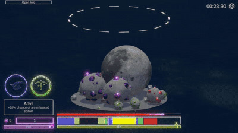
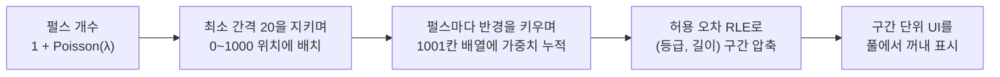
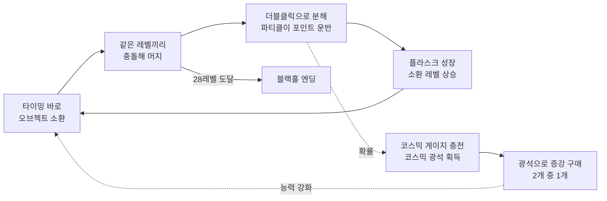

# Blackhole Maker

> 기획부터 Steam 출시까지, 2개월 만에 혼자 완성한 3D 물리 머지 게임

[](https://store.steampowered.com/app/4299820/Blackhole_Maker/)
[](https://unity.com/)

[](https://store.steampowered.com/app/4299820/Blackhole_Maker/)

**타이밍 바로 자원을 소환하고, 같은 단계끼리 합쳐 플라스크 속에 우주를 만드는 게임입니다.** 보석에서 시작해 광석, 행성, 항성을 거쳐 블랙홀을 만들면 엔딩입니다.

| 타이밍 소환 & 머지 | 피버 모드 & 행성 단계 |
| :---: | :---: |
|  |  |

<br>

## 👤 1인 개발 범위

| 영역 | 내용 |
| --- | --- |
| 기획 | 코어 루프, 성장 곡선, 증강 36종 밸런싱, 피버·콤보 시스템, 12단계 튜토리얼 |
| 프로그래밍 | 게임플레이 전체, 절차적 판정 맵, 물리 안정화, 풀링, 세이브/로드, 사운드 |
| 그래픽 연출 | Shader Graph 커스텀 셰이더 29종, 파티클 UI 연출, DOTween 시퀀스 엔딩 |
| 출시 | Steam 입점 · 상점 페이지 · 빌드 배포 (2026. 01. 26 정식 출시) |

개발 기간 **2개월**, 전 과정을 혼자 진행했습니다.

<br>

## 💡 기술 구현

### 1. 푸아송 분포 기반 절차적 타이밍 판정 맵

> `Assets/05.UI/SpawnUI/SpawnPanel.cs`

핵심 입력은 "움직이는 핸드를 성공 구간에 멈추기"입니다. 매 라운드 성공 구간(펄스)을 절차적으로 생성하고, **펄스가 겹칠수록 높은 등급(더 많은 소환)** 이 되도록 설계했습니다.



- **푸아송 난수(Knuth 알고리즘)** 로 펄스 개수를 뽑아, 평균은 λ로 제어하면서 매 판 다른 배치를 만듭니다. 증강과 피버는 λ만 올리면 되므로 난이도와 보상을 **분포 파라미터 하나로** 조절합니다.
- 각 펄스는 코루틴으로 반경이 0에서 목표값까지 퍼지고, 매 프레임 누적 맵을 다시 계산합니다. **화면에 보이는 구간과 실제 판정 맵이 항상 같은 배열**에서 나오므로 연출 도중에도 판정이 어긋나지 않습니다.
- 펄스는 일정 확률로 가중치 2를 갖고(더블 펄스), 누적값은 `MaxNesting`으로 상한을 둡니다. 겹침 횟수가 곧 등급이라 별도 등급 계산 로직이 없습니다.
- 배열을 **허용 오차가 있는 RLE**로 압축해 구간당 UI 1개만 사용합니다. 일정 길이 미만의 값 변화는 노이즈로 보고 앞 구간에 흡수시켜, 잘게 쪼개진 구간이 생기지 않게 했습니다.
- 판정은 핸드의 x좌표를 배열 인덱스로 변환해 읽는 **O(1)** 연산입니다.
- "가장 밝은 / 가장 긴 / 가장 짧은 구간 강화" 증강은 압축된 구간 목록에서 `Max`/`Min` 셀렉터만 바꿔 같은 함수로 처리합니다.

```csharp
// 누적 맵: 겹침 가중치가 곧 등급
for (int i = start; i <= end; i++)
{
    coverage[i] += centers[e].Item2;                       // 일반 1, 더블 펄스 2
    coverage[i] = Mathf.Clamp(coverage[i], 0, MaxNesting);
}

// 판정: 핸드 위치 → 배열 인덱스, O(1)
return Map[Mathf.RoundToInt(HandPos) + Map.Length / 2];
```

### 2. 충돌 이벤트 경합 해결 — 머지 중복 방지

> `Assets/01.Object/Object.cs`

두 오브젝트가 충돌하면 충돌 콜백이 **양쪽 모두에서** 호출되어, 그대로 두면 상위 오브젝트가 2개 생성됩니다. 두 단계로 막았습니다.

1. **결정적 규칙으로 담당자 고정**: y좌표가 낮은 쪽, 같으면 `InstanceID`가 작은 쪽만 머지를 처리합니다.
2. **즉시 잠금**: 담당자가 정해지는 순간 두 오브젝트 모두 `PreventingChange`를 켜서, 풀 반환 트윈이 끝나기 전에 제3의 오브젝트와 다시 머지되는 것을 막습니다.

```csharp
if (obj.Level == Level && !obj.PreventingChange)
{
    if (transform.position.y < collision.transform.position.y ||
       (transform.position.y == collision.transform.position.y &&
        gameObject.GetInstanceID() < collision.gameObject.GetInstanceID()))
    {
        PreventingChange = true;          // 양쪽 모두 즉시 잠금
        obj.PreventingChange = true;
        Spawner.Instance.ReturnObject(obj);
        Spawner.Instance.StartCoroutine(
            Spawner.Instance.SpawnMergedObject(Level + 1, transform.position, false));
        Spawner.Instance.ReturnObject(this);
    }
}
```

### 3. 파티클이 운반하는 포인트

> `Assets/05.UI/Gage/DecomposePS.cs`, `Assets/04.System/FlaskGage.cs`, `Assets/04.System/CosmicGage.cs`

오브젝트를 분해하면 포인트가 즉시 오르지 않고, **파티클이 게이지까지 날아가 충돌하는 순간** 파티클 1개 몫의 포인트가 지급됩니다.

- 분해 시 `(획득 포인트 / 파티클 수)`를 파티클에 싣고, `OnParticleCollision`에서 게이지에 더합니다. 연출과 수치가 구조적으로 일치합니다.
- 월드 공간 파티클을 UI 게이지로 유도하기 위해, 게이지의 스크린 좌표를 다시 월드 좌표로 변환해 매 프레임 파티클 위치를 보간합니다.
- 게이지가 가득 차 레벨업 연출이 도는 동안 도착한 포인트는 버퍼에 모았다가, 연출이 끝난 뒤 **초과분과 합쳐 이월**합니다. 연출 중 포인트 유실이나 중복 레벨업이 없습니다.

### 4. 증강(Objet) 36종과 리플렉션 기반 저장

> `Assets/06.Objet/`, `Assets/04.System/ObjetManager.cs`, `Assets/04.System/DataManager.cs`

- 모든 증강은 `Objet` 추상 클래스(`Init` / `OnEquip`)를 상속합니다. 새 증강은 **클래스 하나를 추가하고 목록에 등록**하면 끝나며, 대부분 5~10줄입니다.
- 증강은 Spawn / Cost / Fever 세 계열이고 최대 5레벨까지 강화됩니다. 상점은 **직전에 고른 것과 같은 계열 1개 + 다른 계열 1개**를 제시해, 빌드를 이어갈지 갈아탈지를 매번 선택하게 합니다.
- 저장은 **타입 이름 목록 + 레벨 문자열**만 기록합니다. 로드 시 `Type.GetType`으로 컴포넌트를 찾아 **레벨 횟수만큼 `OnEquip`을 다시 실행**해 스탯을 재구성하므로, 스탯 값 자체는 저장하지 않습니다. 밸런스 수치를 바꿔도 기존 세이브가 새 수치로 복원됩니다.
- 장착 목록은 `ObservableCollection`이라 변경 시 저장과 정보 UI 갱신이 자동으로 따라옵니다.

```csharp
public class Prism : Objet
{
    public override void OnEquip()
    {
        Spawner.Instance.SpawnPanel.SuccessRange *= 1.2f;
        Spawner.Instance.SpawnPanel.EventMultiplyChance += 0.05f;
        Cost += level + 2;
    }
    // Init(): 이름, 설명, 계열, 최대 레벨, 아이콘
}
```

### 5. 28단계 성장을 버티는 스케일 전략

> `Assets/02.Plask/Flask.cs`, `Assets/04.System/Spawner.cs`, `Assets/04.System/CameraLookController.cs`

오브젝트 크기는 레벨마다 1.75배씩 커져, 1레벨과 27레벨의 차이가 약 200만 배입니다. 한 씬에서 이를 그대로 키우면 물리와 카메라가 버티지 못합니다.

- **플라스크 레벨 10까지는 플라스크를 키우고, 그 이후에는 월드 루트를 0.875배씩 줄입니다.** 플레이어에게는 계속 커지는 것처럼 보이지만 실제 좌표 범위는 일정하게 유지됩니다.
- 카메라는 고정하고 **월드 루트를 회전**시키며, 스카이박스 회전값을 함께 맞춰 카메라가 도는 것처럼 보이게 했습니다. 직교 카메라 크기는 플라스크 스케일을 따라 보간됩니다.
- 질량은 `(scale + 1)³`로 부피에 비례시켜, 큰 천체가 작은 조각에 밀려나지 않게 했습니다.

### 6. 풀링과 연출

- 머지 오브젝트, 분해·업그레이드 파티클, 펄스 이펙트, 성공 구간 UI, **효과음 AudioSource**까지 제네릭 풀(`GetFromPool<T>` / `TakeToPool<T>`)로 재사용합니다. 효과음은 재생이 끝나면 스스로 풀로 돌아갑니다.
- 블랙홀 엔딩은 DOTween `Sequence` 하나로 구성했습니다. 오브젝트 → 플라스크 → UI 순으로 빨려 들어가며 3단계로 화면 흔들림이 강해지고, 마지막에 플레이 통계가 담긴 크레딧이 올라옵니다.
- 보석, 광석, 항성, 블랙홀, 게이지, 성공 구간 등 **Shader Graph 29종**을 직접 제작했습니다.

<br>

## 🩹 물리 게임을 안정적으로 만들기 위한 보정

물리 기반 머지는 "가끔 이상하게 동작하는" 경우가 끝없이 나옵니다. 플레이 테스트에서 발견한 문제를 다음과 같이 보정했습니다.

| 문제 | 보정 | 위치 |
| --- | --- | --- |
| 소환 직후 오브젝트끼리 닿자마자 연쇄 머지가 폭주함 | 생성 후 0.75~1.25초(머지 결과물은 0.25~0.5초) 동안 머지·분해를 막는 보호 시간. 시간을 무작위로 줘서 동시 머지를 분산 | `Object.PreventMerge` |
| 보호 시간 중에 이미 맞닿은 쌍은 `OnCollisionEnter`가 다시 오지 않아 영영 머지되지 않음 | `OnCollisionStay`에서도 같은 판정을 수행 | `Object.OnCollisionStay` |
| 위에서 떨어지는 오브젝트가 뚜껑에 막힘 | 생성 시 뚜껑과의 충돌을 끄고, 안착한 뒤에 다시 켬 | `Object.PreventMerge` |
| 플라스크가 커지면 낙하가 느려 보임 | 보호 시간 동안 플라스크 스케일에 비례한 추가 중력 적용 | `Object.PreventMerge` |
| 머지 결과물이 플라스크 밖 허공에 생성됨 | 아래로 레이캐스트해 바닥이 없으면 중심으로 끌어옴 | `Object.PreventMerge` |
| 빠른 오브젝트가 바닥을 뚫고 떨어짐 | 바닥 트리거에서 위쪽 속도를 주고, 그래도 빠지면 스폰 지점으로 되돌린 뒤 보호 시간 재시작 | `Floor`, `Object.FixedUpdate` |
| 같은 지점에 여러 개가 겹쳐 생성되어 튕겨 나감 | 생성 위치에 ±0.05 지터와 무작위 수평 속도 부여 | `Spawner.Spawn` |
| 멈춘 오브젝트가 가장자리에 고여 머지가 안 일어남 | 속도가 거의 0이면 중심 방향으로 크기에 비례한 힘을 가함 | `Object.FixedUpdate` |
| 방금 생성된 오브젝트가 넘침으로 잘못 판정됨 | 보호 시간 중인 오브젝트는 넘침 카운트에서 제외 | `Lid.Update` |
| 콤보로 핸드 속도가 바뀌는 순간 핸드 위치가 튐 | 왕복 시간이 바뀌면 진행 시간을 새 주기에 맞게 정규화 | `SpawnPanel.MoveHandRoutine` |
| 성공 구간이 펼쳐지는 중에 입력하면 판정이 불공정함 | 펄스가 퍼지는 0.5초 동안 입력을 받지 않음 | `SpawnPanel.IsWaiting` |
| 구간마다 머티리얼을 복제하면서 인스턴스가 누적됨 | 풀로 되돌릴 때 인스턴스 머티리얼을 명시적으로 파괴 | `SpawnPanel.AnimateSuccessRanges` |
| 펄스 배치가 조건을 만족하지 못해 무한 루프 가능 | 위치 재추첨을 100회로 제한 | `SpawnPanel.GenerateEventPositions` |
| 작은 머지 소리가 수십 개 겹쳐 시끄러움 | 현재 최대 레벨 대비 비율로 볼륨을 감쇠하고 피치를 무작위화 | `Object.Level` |
| 값이 바뀔 때마다 디스크에 저장해 끊김 | 값은 메모리에만 쓰고 60초 주기와 종료 시점에만 저장 | `DataManager` |
| 로드 시 증강 컴포넌트가 중복 생성됨 | 기존 컴포넌트를 먼저 찾고 없을 때만 추가 | `DataManager.AddComponentByName` |

<br>

## 🔄 시스템 구조



```
Assets/
├─ 01.Object/   머지 오브젝트, 블랙홀, 메시·머티리얼 데이터 (ScriptableObject)
├─ 02.Plask/    플라스크 · 뚜껑 · 바닥
├─ 04.System/   스포너, 게이지, 증강 관리, 세이브, 입력, 카메라
├─ 05.UI/       타이밍 바, 게이지 이펙트, 메인/엔딩 UI
├─ 06.Objet/    증강 36종 정의
├─ 07.Sound/    사운드 매니저와 효과음
├─ Editor/      메시·머티리얼 데이터용 커스텀 인스펙터
└─ Modules/     제네릭 오브젝트 풀 모듈
```

<br>

## 🛠 기술 스택 & 실행

**Unity 6 (6000.3.2f1)** · C# · URP · Shader Graph · New Input System · DOTween · Redcode.Pools · Unity UI Extensions

- **플레이**: [Steam 상점 페이지](https://store.steampowered.com/app/4299820/Blackhole_Maker/)
- **소스 실행**: Unity 6000.3.2f1로 열고 `Assets/Scenes/Main.unity` 씬에서 시작
- **조작**: `Space` 소환 · 좌클릭 더블클릭 분해 · 좌클릭 드래그로 플라스크 흔들기 · 우클릭 드래그로 회전
