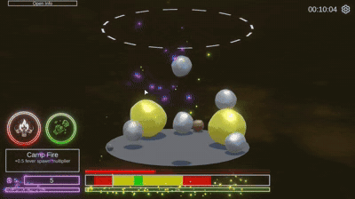

# Blackhole Maker

[](https://store.steampowered.com/app/4299820/Blackhole_Maker/)
[](https://unity.com/)

[](https://store.steampowered.com/app/4299820/Blackhole_Maker/)

**[English](#english)** | **[한국어](#korean)**

| Early game | Late game | Augment shop |
| :---: | :---: | :---: |
|  |  |  |

<br>

<a id="english"></a>

## English

> A 2-month vacation project

Inspired by Suika Game, this is a merge game where you start from small stones and grow them all the way into a black hole.

### Solo Development Scope

| Area | Details |
| --- | --- |
| Design | Core loop, growth curve, balancing 36 augments, fever and combo systems, tutorial |
| Programming | All gameplay, procedural timing bar, physics stabilization, pooling, save/load, sound |
| Visual effects | 29 custom Shader Graph shaders, particle-based UI effects |
| Release | Steam store page and build distribution (released on January 26, 2026) |

<br>

### Technical Implementation

#### 1. Procedural Timing Bar Based on the Poisson Distribution

The core input is "stop the moving hand on a success zone." Each round, success zones (pulses) are generated procedurally, and the more pulses overlap, the higher the grade (more objects spawned).

- Each pulse is treated as an independent random event (arrival), and the number of pulses in a round is drawn from a Poisson distribution.
- Because the Poisson distribution is defined by a single parameter, the mean arrival count λ, stat upgrades from augments or fever and overall balancing can all be handled through that one parameter.
- Pulse counts are drawn with **Poisson random sampling (Knuth's algorithm)**, producing a different layout every round.

#### 2. Resolving Collision Event Races to Prevent Duplicate Merges

When two objects collide, the collision callback fires on both of them, which would create two higher-level objects.

1. Only the object with the lower y-position merges; if the y-positions are equal, the one with the smaller `InstanceID` does.
2. As soon as the merging side is decided, both objects set `PreventingChange`, so neither can merge again with a third object.

#### 3. 36 Augments (Objets) and Reflection-Based Saving

- Every augment inherits from the abstract `Objet` class (`Init` / `OnEquip`). Adding a new augment only takes one new class registered in the list.
- Augments come in three families (Spawn / Cost / Fever) and can be upgraded up to level 5. The shop offers one augment from the same family as the last pick and one from a different family, so players choose every time whether to continue their build or switch.
- Saves store **only the type names and levels of equipped augments**, not stat values.
- On load, components are found with `Type.GetType`, and `OnEquip` is re-run once per level to rebuild the stats. Because of this, existing saves pick up new values when balance numbers change in a patch.
- The equipped list is an `ObservableCollection`, so saving and the info UI update automatically whenever it changes.
- The two choices currently shown in the shop are also saved, so restarting the game cannot be used to reroll them.

#### 4. Controlling Scale Explosion

Objects grow 1.75× per level, so a level 27 object is about 2,000,000 times larger than a level 1 object. Scaling that directly in one scene would break both physics and the camera.

- Up to flask level 10 the flask itself grows; after that, the world root shrinks by 0.875× instead. To the player everything keeps getting bigger, while the actual coordinate range stays constant.
- Object mass is set to `(scale + 1)³`, proportional to volume, so large celestial bodies are not pushed around by small fragments.

<br>

### Troubleshooting

Fixes for awkward behavior and tweaks made to improve gameplay.

| Problem | Fix |
| --- | --- |
| Objects merged in a runaway chain the moment they touched after spawning | A protection window after spawning during which merging and decomposing are blocked; its length is randomized to spread out simultaneous merges |
| Falling looked slow once the flask grew larger | Extra gravity proportional to the flask scale during the protection window |
| Stopped objects piled up at the edges and never merged | When velocity is near zero, a force proportional to size pushes them toward the center |
| Dozens of small merge sounds overlapping became noisy | Volume is attenuated relative to the current max level, and pitch is randomized |
| Pulses that differed by only a few pixels made the UI look cluttered | Run-length encoding with a tolerance absorbs tiny segments into the previous one so the bar is not split into fragments |

<br>

### Project Structure

```
Assets/
├─ 01.Object/   Merge objects, black hole, mesh/material data (ScriptableObject)
├─ 02.Plask/    Flask, lid, floor
├─ 04.System/   Spawner, gauges, augment manager, save, input, camera
├─ 05.UI/       Timing bar, gauge effects, main/ending UI
├─ 06.Objet/    36 augment definitions
├─ 07.Sound/    Sound manager and sound effects
├─ Editor/      Custom inspector for mesh/material data
└─ Modules/     Generic object pool module
```

<br>

### Tech Stack & How to Play

**Unity 6 (6000.3.2f1)** · C# · URP · Shader Graph · New Input System · DOTween · Redcode.Pools · Unity UI Extensions

- **Play**: [Steam store page](https://store.steampowered.com/app/4299820/Blackhole_Maker/)
- **Controls**: `Space` to spawn · double left-click to decompose · left-click drag to shake the flask · right-click drag to rotate

<br>

---

<a id="korean"></a>

## 한국어

> 2개월 방학 프로젝트

수박 머지 게임에서 아이디어를 얻어 돌부터 시작하여 블랙홀까지 만드는 게임입니다.

### 1인 개발 범위

| 영역 | 내용 |
| --- | --- |
| 기획 | 코어 루프, 성장 곡선, 증강 36종 밸런싱, 피버·콤보 시스템, 튜토리얼 |
| 프로그래밍 | 게임플레이 전체, 절차적 타이밍 바, 물리 안정화, 풀링, 세이브/로드, 사운드 |
| 그래픽 연출 | Shader Graph 커스텀 셰이더 29종, 파티클 UI 연출 |
| 출시 | Steam · 상점 페이지 · 빌드 배포 (2026. 01. 26 정식 출시) |

<br>

### 기술 구현

#### 1. 푸아송 분포 기반 절차적 타이밍 바

핵심 입력은 "움직이는 핸드를 성공 구간에 멈추기"입니다. 매 라운드 성공 구간(펄스)을 절차적으로 생성하고, 펄스가 겹칠수록 높은 등급(더 많은 소환) 이 되도록 설계했습니다.
- 펄스의 등장을 서로 독립적인 무작위 사건(arrival)으로 보고, 한 라운드에 나타나는 개수를 푸아송 분포로 뽑습니다.
- 푸아송 분포는 평균 등장 횟수 λ 하나로 정의되므로, 증강이나 피버 같은 능력치 상승과 밸런스 조절을 파라미터 하나로 처리할 수 있습니다.
- **푸아송 난수(Knuth 알고리즘)** 로 펄스 개수를 뽑아 매 라운드 다른 배치를 만듭니다.

#### 2. 충돌 이벤트 경합 해결, 머지 중복 방지

두 오브젝트가 충돌하면 충돌 콜백이 양쪽 모두에서 호출되어 상위 오브젝트가 2개 생성됩니다.

1. y좌표가 낮은 쪽, 같으면 `InstanceID`가 작은 쪽만 머지를 처리합니다.
2. 머지를 담당할 쪽이 정해지는 순간 두 오브젝트 모두 `PreventingChange`를 켜서 제3의 오브젝트와 다시 머지되는 것을 막습니다.

#### 3. 증강(Objet) 36종과 리플렉션 기반 저장

- 모든 증강은 `Objet` 추상 클래스(`Init` / `OnEquip`)를 상속합니다. 새 증강은 클래스 하나를 추가하고 목록에 등록하면 됩니다.
- 증강은 Spawn / Cost / Fever 세 계열이고 최대 5레벨까지 강화됩니다. 상점은 직전에 고른 것과 같은 계열 1개 + 다른 계열 1개를 제시해, 빌드를 이어갈지 갈아탈지를 매번 선택하게 합니다.
- 저장은 **장착한 증강의 타입 이름과 레벨**만 기록하고, 스탯 값은 저장하지 않습니다.
- 로드 시 `Type.GetType`으로 컴포넌트를 찾고, 레벨 횟수만큼 `OnEquip`을 다시 실행해 스탯을 재구성합니다. 그래서 패치로 밸런스 수치를 바꿔도 기존 세이브가 새 수치로 복원됩니다.
- 장착 목록은 `ObservableCollection`으로 관리해, 변경될 때마다 저장과 정보 UI 갱신이 자동으로 이뤄집니다.
- 상점에 떠 있는 선택지 2개도 저장하여 게임을 껐다 켜서 선택지를 다시 뽑는 것을 막았습니다.

#### 4. 스케일 폭발 제어

오브젝트 크기는 레벨마다 1.75배씩 커져, 1레벨과 27레벨의 차이가 약 200만 배입니다. 한 씬에서 이를 그대로 키우면 물리와 카메라가 버티지 못합니다.

- 플라스크 레벨 10까지는 플라스크를 키우고, 그 이후에는 월드 루트를 0.875배씩 줄입니다. 플레이어에게는 계속 커지는 것처럼 보이지만 실제 좌표 범위는 일정하게 유지됩니다.
- 오브젝트 질량은 `(scale + 1)³`로 부피에 비례시켜, 큰 천체가 작은 조각에 밀려나지 않게 했습니다.

<br>

### 트러블슈팅

어색하게 동작하는 것을 고치거나 게임성 개선을 위해 적용한 것들입니다.

| 문제 | 보정 |
| --- | --- |
| 소환 직후 오브젝트끼리 닿자마자 연쇄 머지가 폭주함 | 생성 후 일정 시간 동안 머지·분해를 막는 보호 시간. 시간을 무작위로 줘서 동시 머지를 분산 |
| 플라스크가 커지면 낙하가 느려 보임 | 보호 시간 동안 플라스크 스케일에 비례한 추가 중력 적용 |
| 멈춘 오브젝트가 가장자리에 고여 머지가 안 일어남 | 속도가 거의 0이면 중심 방향으로 크기에 비례한 힘을 가함 |
| 작은 머지 소리가 수십 개 겹쳐 시끄러움 | 현재 최대 레벨 대비 비율로 볼륨을 감쇠하고 피치를 무작위화 |
| 수 px 단위로 펄스가 겹치지 않으면 UI가 지저분해 보임 | 허용 오차가 있는 RLE로 압축하여 앞 구간에 흡수시켜 자잘하게 구분되지 않게 함 |

<br>

### 시스템 구조

```
Assets/
├─ 01.Object/   머지 오브젝트, 블랙홀, 메시·머티리얼 데이터 (ScriptableObject)
├─ 02.Plask/    플라스크 · 뚜껑 · 바닥
├─ 04.System/   스포너, 게이지, 증강 관리, 세이브, 입력, 카메라
├─ 05.UI/       타이밍 바, 게이지 이펙트, 메인/엔딩 UI
├─ 06.Objet/    증강 36종 정의
├─ 07.Sound/    사운드 매니저와 효과음
├─ Editor/      메시·머티리얼 데이터용 커스텀 인스펙터
└─ Modules/     제네릭 오브젝트 풀 모듈
```

<br>

### 기술 스택 & 실행

**Unity 6 (6000.3.2f1)** · C# · URP · Shader Graph · New Input System · DOTween · Redcode.Pools · Unity UI Extensions

- **플레이**: [Steam 상점 페이지](https://store.steampowered.com/app/4299820/Blackhole_Maker/)
- **조작**: `Space` 소환 · 좌클릭 더블클릭 분해 · 좌클릭 드래그로 플라스크 흔들기 · 우클릭 드래그로 회전
